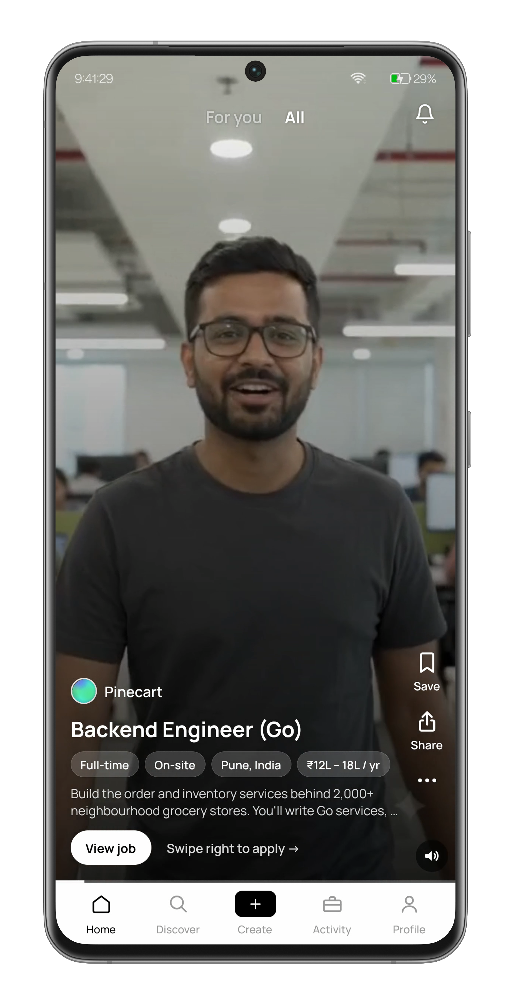
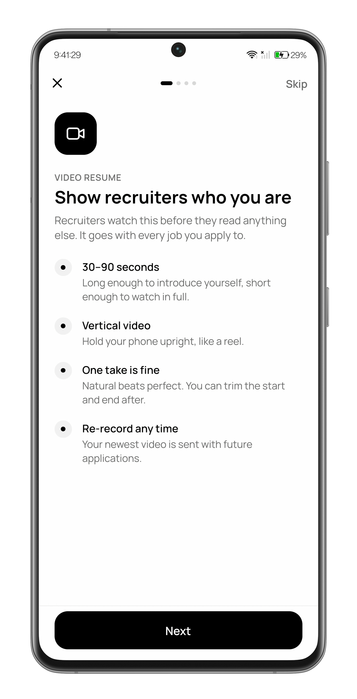
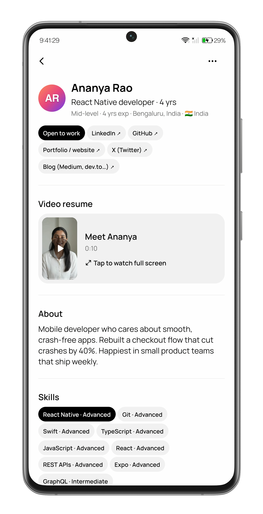

# ReelHire

**Tech hiring, told in reels.**

ReelHire is a video-first hiring app for tech roles. Every candidate applies with a short video resume, and every job is posted as a video reel. You see how someone thinks and talks before you ever book a call.

  
  
  

> **ReelHire is in development.** The app is Android-only for now and not yet on the Play Store. [Join early access](https://forms.gle/Zr3usJ3wmjMvvgLo8) to be among the first to try it.

## Who it's for

ReelHire is only for tech roles, so every reel in your feed is relevant.

- **Job seekers** (engineers, designers and product managers): your reel is your application. Record a short pitch or walk through something you built, and show how you think, not just where you've worked.
- **Recruiters**: every applicant arrives with a reel, so you hear how they explain their work before the first call. Filter by stack, level and location, then watch the shortlist.
- **Startup founders**: a copy-paste job description can't say why your team is worth joining, but a 60-second reel in your own voice can.
- **Hiring managers**: message candidates straight from their reel and keep everything, from first watch to offer, in one conversation.

## How it works

1. **Record your reel.** A built-in guide takes you through an intro, your experience and a close. Trim it, re-record it whenever you like, and post a 20 to 90 second pitch.
2. **Swipe, watch, apply.** Browse job reels filtered to your stack and level. Swipe up to apply.
3. **Chat and get hired.** Get shortlisted, set up interviews and follow every application's status in one place.

## What's inside

- Video resumes and job reels
- Filters for stack, experience level and location
- Searchable transcripts of every reel
- In-app chat between candidates and teams
- A live status for every application: Sent, Shortlisted, Interview, Hired or Not selected
- Block and report controls, so you're always in charge of who can reach you

## Pricing

| Plan | Who it's for | Price |
| --- | --- | --- |
| **Seeker** | Engineers, designers and PMs looking for their next role | Free, always |
| **Recruiter** | Individual recruiters and hiring managers, with up to 5 active job reels | Coming soon |
| **Startup** | Founders hiring for several roles, with unlimited job reels | Coming soon |

## Common questions

**Do I need a video to apply?**
Yes. Every application starts with your reel, because it's the first thing a team sees. The guided recorder makes it quick, even if you've never filmed yourself.

**How long should my reel be?**
Between 20 and 90 seconds. Most strong reels are about a minute: a quick intro, one or two things you've built or shipped, and what you're looking for next.

**Do companies have to make a video too?**
Yes. Every job on ReelHire is posted as a reel. A phone and 60 seconds are enough.

**Can I withdraw an application?**
Yes, any time before a decision is made.

## Get in touch

- Website: [reelhire.xyz](https://reelhire.xyz)
- Email: [support@reelhire.xyz](mailto:support@reelhire.xyz)
- [Privacy Policy](https://reelhire.xyz/privacy) · [Terms of Service](https://reelhire.xyz/terms)
